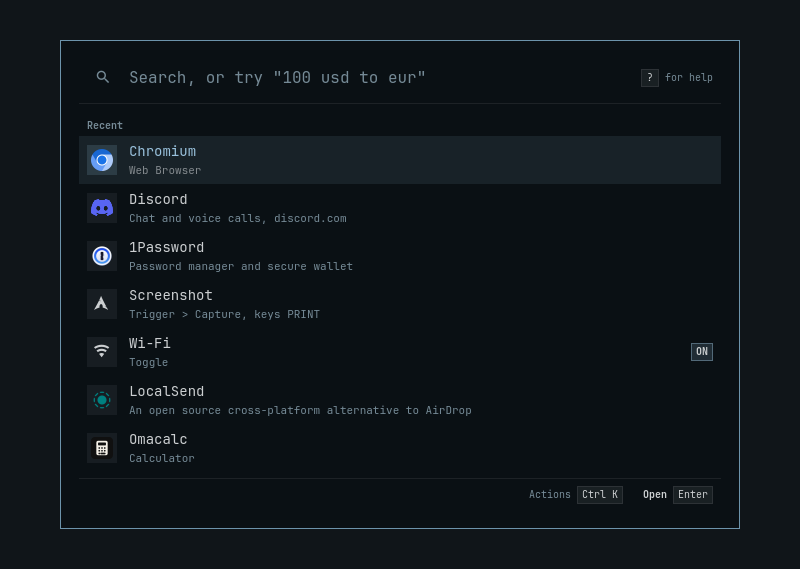

# Nodi

A command bar for [Omarchy](https://omarchy.org). Press Super+Period, type,
press Enter.



Nodi (நொடி) is Tamil for an instant.

## Features

- Apps, windows with live screencopy previews, and Hyprland window rules from Ctrl+K
- Every action and toggle in Omarchy's menu with live ON/OFF state
- Math sums, unit conversions, daily offline currency rates, time zones, dates and dictionary definitions
- Fast file search, ripgrep content search, syntax-highlighted code previews, and file chooser jumps
- Searchable clipboard history with OCR text detection inside images, pinned clips, and sequence pasting
- Upcoming calendar meeting countdowns and direct join links (Meet, Zoom, Teams)
- Arch Linux and AUR package installer and search (`pkg`)
- Conversational answers from Claude, Codex, OpenCode, Pi, Agy, or your own agent over ACP
- Active context mentions (`@w` for window, `@c` for clipboard, `@s` for selection), standing instructions, and background completion notices
- Quick actions on selected text: fix grammar, rewrite, summarize, translate, and change case
- Custom bash scripts, rofi-compatible script filters, custom streaming answers, and a 10-minute action undo stack

## Requirements

Omarchy 4. For `ask` and the actions on selected text, a signed-in coding
agent: [Claude Code](https://claude.com/claude-code), or the `codex`,
`opencode`, `pi` or `agy` command ([Ask](docs/ask.md)). Claude, Pi and Agy
need Node.js 22 and npm; Codex needs Node.js 20 and npm. Codex also needs a
separate sign-in for Nodi's profile.
The first question installs Claude's, Codex's, Pi's or Agy's ACP adapter
from npm, at the versions `lib/adapters` locks, with no install scripts.

## Install

```sh
omarchy plugin add https://github.com/itsgg/omarchy-nodi --enable
```

Update with `omarchy plugin update io.github.itsgg.nodi`.

## Remove

```sh
omarchy plugin remove io.github.itsgg.nodi
```

That releases its hotkey and the hotkeys you gave rows, turns off the
window rules you set from Ctrl+K, and stops Ask's agent. A key another
binding shares stays until Hyprland reloads, as releasing it would
release both. What it keeps of yours stays until you delete it: your
settings
(`~/.config/omarchy/extensions/nodi.json`), what you set on rows
(`~/.local/state/nodi`), its caches (`~/.cache/nodi`) and Ask's agent
adapters and private Codex profile (`~/.local/share/nodi`; its size depends
on which agents have been asked):

```sh
rm -rf ~/.config/omarchy/extensions/nodi.json ~/.local/state/nodi ~/.cache/nodi ~/.local/share/nodi
```

Pasting the clipboard in sequence and sending a pinned text leave a few
files in `$XDG_RUNTIME_DIR` (`nodi-sequence`, `nodi-share.*.txt`), which
go at logout.

## Usage

| Type | To |
|---|---|
| `chrom` | open an app |
| `w git` | switch to a window (with live preview) |
| `screenshot`, `gaps` | run a menu action, flip a toggle |
| `12*8 + 15%`, `5 km to mi` | calculate sums, convert units |
| `$50`, `3pm to tokyo` | convert currency, compare time zones |
| `cb invoice` | search clipboard history (including image OCR) |
| `find report`, `in todo` | find files by name, search file contents |
| `pkg ripgrep` | search and install pacman and AUR packages |
| `cal` | check meetings and join video calls |
| `note call bank` | append a dated note to Markdown |
| `define serendipity` | lookup dictionary definitions |
| `fix`, `tr es Hello` | fix or translate selected text |
| `ask @w why this error` | ask your coding agent with active window context |
| `undo` | undo a recent action |
| `?` | see everything it does |

Enter runs the selected row, Ctrl+K shows its other actions, Esc closes.

## Documentation

The [guide](docs/README.md) covers every key, action and setting,
extending Nodi, and what it reads and sends.

## Development

```sh
make check    # what CI runs, and more
make reload   # install this tree and restart the shell
```

[PLAN.md](PLAN.md) explains the design; [CHANGELOG.md](CHANGELOG.md)
lists the releases.

## Credits

The calculator, units, currency, time zones, dates, emoji, processes and
the matching of windows and apps began as ports from Saikomantisu's
[Command Bar](https://github.com/Saikomantisu/omarchy-commandbar) (MIT),
whose copyright [LICENSE](LICENSE) carries too.

## License

[MIT](LICENSE)
